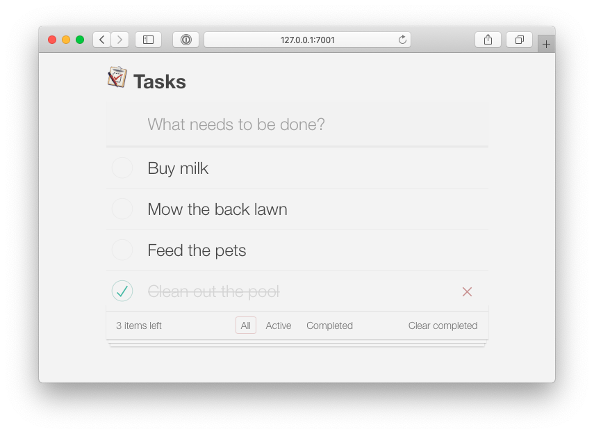
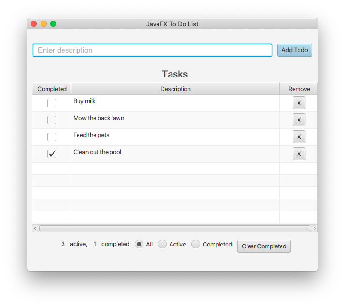
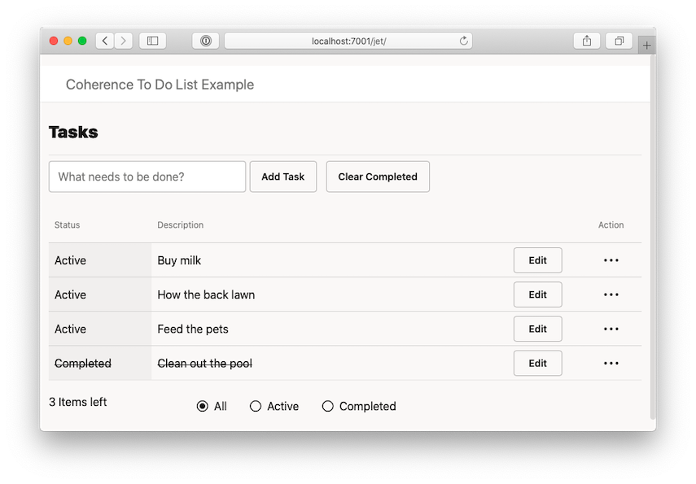

# Coherence To Do List Example Application for Helidon

## Build Instructions

1. Build the Helidon Project

Run the following from the project root directory at `helidon-server/`

 ```bash
 mvn clean install
 ```

## Running the Example

### Run the server

```bash  
mvn exec:exec
```
   
### Access the Web UI
  
Access via http://localhost:7001/
   

   
### Run the JavaFX Client

```bash  
cd ../helidon-client
mvn javafx:run
```
        


## Build and Run the Oracle JET UI (Optional)

If you wish to run the Oracle JET UI, please carry out the following:

1. Install the JET CLI

    ```bash
    npm install -g @oracle/ojet-cli
    ```   
   
2. Build JET UI
   
    ```bash
    cd helidon-server/src/main/web/jet
    npm install
    ojet build
    ```
            
3. Re-Build the Project

    Run the following from the project root directory:

    ```bash
    mvn clean install
    ```          

4. Access the Web UI

   Run the server as mentioned above and access the UI via http://localhost:7001/jet/   
   
   
    
## Kubernetes health control

Both deployment manifests use `spec.healthMutatorConnection` so the Operator can
authenticate service suspension during normal deletion. Coherence 26.10 disables
health mutators by default. The managed connection enables them with Basic
authentication, packaged JAAS and verified TLS; read-only health probes use HTTPS.

Install an Operator **and compatible CRD** that support `healthMutatorConnection`.

Before applying either manifest, create its Secrets in the same namespace. From
the repository root, with `kubectl`, JDK `keytool` and `openssl` installed:

```bash
CONTEXT=rancher-desktop # Use your cluster's context.
NAMESPACE=todo-list
kubectl --context "$CONTEXT" create namespace "$NAMESPACE"
bin/setup-helidon-health.sh "$CONTEXT" "$NAMESPACE"
kubectl --context "$CONTEXT" -n "$NAMESPACE" apply -f java/helidon-server/src/main/microk8s/app.yaml
# Alternatively, apply src/main/k8s/app.yaml from this module.
```

The helper generates a random password and a self-signed demo certificate for
`todo-health.local`, valid for 365 days. It creates three immutable, versioned
Secrets (`todo-health-auth-v1`, `todo-health-stores-v1`, `todo-health-ca-v1`), removes
temporary private files, and refuses to overwrite existing Secrets. Keep the
Secrets until the Coherence resource has finished deleting:

```bash
kubectl --context "$CONTEXT" -n "$NAMESPACE" delete coherence.coherence.oracle.com/todo-list
kubectl --context "$CONTEXT" -n "$NAMESPACE" delete secret todo-health-auth-v1 todo-health-stores-v1 todo-health-ca-v1
```

For a long-lived deployment, provision certificates and credentials through your
secret-management process and update the references together before expiry. The
helper is intended for fresh demo deployments.

## Monitoring

Both the [Kubernetes](src/main/k8s/app.yaml) and
[MicroK8s](src/main/microk8s/app.yaml) examples enable two independent metrics
endpoints:

| Metrics | HTTP endpoint | Service and ServiceMonitor |
| --- | --- | --- |
| Helidon framework metrics | Port 7001, `/metrics` | `todo-list-http`, named port `http` |
| Coherence metrics | Port 9612, `/metrics` | `todo-list-metrics`, named port `metrics` |

The manifests enable Coherence metrics and request a ServiceMonitor for each
endpoint. The named `metrics` port uses the Coherence Operator's default port
9612. Verify the installed Operator and compatible CRDs for your deployment.

Install Prometheus and the Prometheus Operator separately, including the
ServiceMonitor CRD. Configure Prometheus's `serviceMonitorSelector` and
`serviceMonitorNamespaceSelector` to select the generated monitors. If the
selector requires additional labels, set them on the relevant port's
`serviceMonitor.labels`. Creating a monitor alone does not guarantee scraping;
verify that both targets are discovered and successfully scraped.

These demo manifests explicitly set `coherence.metrics.http.auth=none` so
Coherence metrics can be scraped without credentials. Anyone who can reach that
endpoint can read its metrics. This setting applies to the separate Coherence
endpoint; it does not change Helidon HTTP authentication or serialization
hardening. For authenticated Coherence metrics, remove the `none` override,
configure the runtime `CoherenceREST` JAAS login context, and supply matching
Secret-backed `serviceMonitor.basicAuth` credentials. See the
[Java security guidance](../README.md#coherence-2610-and-hardened-mode).

## References

* [Coherence Community Edition](https://github.com/oracle/coherence)
* [Project Helidon](https://helidon.io/)
* [Coherence Community Home Page](https://coherence.community/)
* [Oracle JavaScript Extension Toolkit (JET)](https://www.oracle.com/webfolder/technetwork/jet/index.html)


